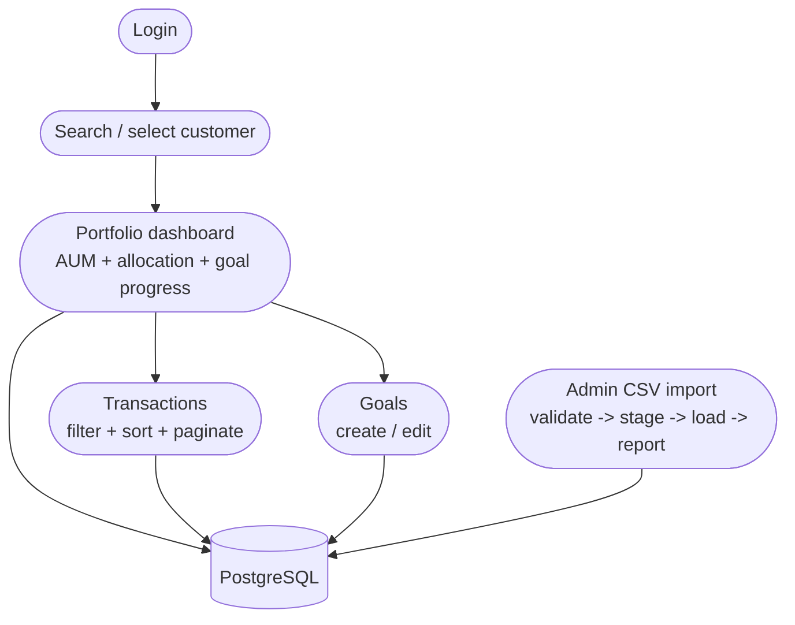
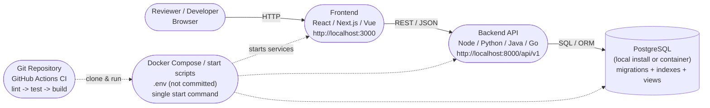

# FINPILOT

## Full-Stack Fintech Coding Assignment

Frontend | Backend | REST API | PostgreSQL | Local Hosting | CI/CD | Architecture

**Use case: Investment Portfolio & Goal Monitoring Platform**

*Synthetic assessment data only • No real customer or market data*

## 1. Assignment Purpose

Build and deploy a small but production-minded fintech web application that allows an operations or wealth-service user to inspect a customer’s investment accounts, holdings, recent transactions, risk profile and financial goals. The application must consume the supplied CSV datasets, persist clean data in PostgreSQL, expose it through a documented API and present it in a responsive frontend.

The assessment is designed to reveal engineering judgment rather than framework memorisation. You may choose your preferred modern stack, but you must be able to explain your choices, trade-offs and production-hardening approach.

| **Area** | **What this assignment should demonstrate** |
| --- | --- |
| Frontend | Component design, state management, UX, responsive layouts, error/loading states, tables/charts. |
| Backend | Clean service boundaries, validation, business logic, logging, error handling and tests. |
| API | REST design, status codes, pagination/filtering, OpenAPI/Swagger, auth and versioning approach. |
| PostgreSQL | Data modelling, migrations, constraints, joins/aggregations, indexes, data import and query performance. |
| Deployment | Reproducible local setup, environment configuration, secrets handling, health checks and a documented start-up process. |
| CI/CD + Git | Repository quality, commit discipline, automated lint/test/build and deployment flow. |
| Architecture | Clear diagrams, workflows, ERD, API flows, deployment topology, security and trade-offs. |

## 2. Recommended Scope and Timebox

Recommended effort: approximately 12–16 focused engineering hours. A strong, well-structured partial implementation is preferable to a large amount of fragile code. Clearly document anything you intentionally defer.

- Must work end-to-end for at least one reviewer account/customer flow.
- Do not build payment execution, brokerage order routing or real investment advice.
- All supplied data is synthetic; do not replace it with scraped or real personal data.
- Use PostgreSQL as the primary application database. SQLite-only submissions are not acceptable.
- Use Git from the start. The final repository should preserve meaningful history rather than one final dump commit.

## 3. Product Scenario

FinPilot is a fictional fintech platform used by an internal service team to understand a customer’s consolidated investment position. The first release is read-heavy, but users should also be able to maintain customer goals and an administrator should be able to import data safely.

| **Persona** | **Primary need** |
| --- | --- |
| Service / Wealth user | Search for a customer and understand portfolio value, allocation, goals and recent activity. |
| Operations administrator | Load daily CSV data, see validation failures and avoid duplicate loads. |
| Engineering reviewer | Verify API behaviour, database integrity, deployment, logs, CI/CD and code quality. |

*Figure 1. Example user and data workflow. Candidates may improve this design.*

## 4. Functional Requirements

### 4.1 Authentication and Access

- Provide a basic sign-in flow. A seeded demo user is acceptable; document the credentials safely in the README or deployment notes.
- Protect application pages and non-public API endpoints. Explain the chosen session/JWT strategy and token storage.
- At minimum support two logical roles: VIEWER and ADMIN. ADMIN may access data-import functionality.

### 4.2 Customer Search and Profile

- Search or filter customers by customer ID, name, email or city.
- Customer profile should show core customer details, KYC status, segment and latest risk profile.
- Provide clear empty/loading/error states; do not assume every customer has every data relationship.

### 4.3 Portfolio Dashboard

- Calculate total market value from the clean holdings snapshot and latest synthetic prices.
- Show allocation by asset class; a chart is strongly encouraged.
- Show per-position quantity, average cost, latest price, market value and unrealised gain/loss.
- Show account-level and customer-level totals. The implementation should avoid doing all aggregation in browser JavaScript.
- Display the price date and snapshot date so the user can understand data freshness.

### 4.4 Transactions

- Paginated transaction list with filters for date range, account, instrument and transaction type.
- Backend pagination and filtering are required; loading the entire transaction table and filtering only in the browser is insufficient.
- Reversed and pending transactions should be visually distinguishable.

### 4.5 Goals

- List the customer’s financial goals and show funded percentage = current_funded_amount / target_amount.
- Allow creation and editing of goals with input validation and sensible error messages.
- Highlight overdue or logically inconsistent goals if encountered.

### 4.6 CSV Import / Data Quality

- Implement at least one administrator import endpoint or UI workflow for CSV data. Transactions are the preferred example.
- Imports should be idempotent or safely reject duplicates. Do not silently overwrite data without an explicit rule.
- Validate foreign keys, dates, enumerations and numeric fields. Record or return rejected-row reasons.

The supplied data intentionally contains several anomalies. Identify them and explain your chosen handling in the architecture report.

- Bonus: stage files first, then merge valid records into final tables inside a transaction.

## 5. Minimum API Surface

The exact naming may differ, but the submission should offer equivalent behaviour. Version the API (for example `/api/v1`).

| **Method** | **Example endpoint** | **Required behaviour** |
| --- | --- | --- |
| POST | /auth/login | Authenticate demo user / establish session. |
| GET | /customers | Search, filter and paginate customers. |
| GET | /customers/{id} | Customer profile + latest risk summary. |
| GET | /customers/{id}/portfolio | Customer/account totals, asset allocation and positions. |
| GET | /customers/{id}/transactions | Server-side filters, sorting and pagination. |
| GET | /customers/{id}/goals | List goals and funded percentages. |
| POST | /customers/{id}/goals | Create a validated goal. |
| PATCH | /goals/{goalId} | Edit selected goal fields. |
| POST | /admin/imports/transactions | Validate/import CSV; return counts and rejected rows. |
| GET | /health | Liveness/readiness information without exposing secrets. |

API documentation: publish OpenAPI/Swagger or an equivalent machine-readable specification. Include example requests/responses for at least the portfolio and import endpoints.

## 6. PostgreSQL Requirements

- Create an explicit relational schema. Use primary keys, foreign keys, suitable data types, NOT NULL constraints, unique constraints and CHECK constraints where appropriate.
- Use migrations. The reviewer should be able to create the schema from a clean database using documented commands.
- Create practical indexes based on query patterns, not indexes on every column. Be prepared to show and explain at least one `EXPLAIN (ANALYZE, BUFFERS)` result.
- Use parameterised queries or a well-configured ORM/query builder. Avoid SQL injection risks.
- Use database transactions for multi-step writes/import merges.
- Provide at least one useful view or query layer for portfolio aggregation, monthly net flows, asset allocation, or reconciliation exceptions.
- Document how you would manage connection pooling, backups, migration rollback and production credentials.

### 6.1 SQL Tasks the reviewer may ask you to demonstrate

- Top 10 customers by current snapshot AUM.
- Asset-class allocation for one customer and for the whole dataset.
- Monthly BUY/SELL net cash flow for the last 12 months.
- Top instruments by number of distinct holders.
- Customers with high-priority goals below 25% funded.
- Data-quality/reconciliation exceptions such as duplicate positions, duplicate transaction IDs or invalid references.

## 7. Frontend Requirements

- Use a modern framework such as React/Next.js, Vue/Nuxt, Angular or equivalent.
- Provide a clean dashboard that is usable at desktop and tablet widths; basic mobile responsiveness is expected.
- Use reusable components rather than a single monolithic page.
- Charts should have labels/tooltips and accessible fallback text where practical.
- Large tables should support pagination and avoid unnecessary re-renders.
- Handle API loading, empty, validation and failure states intentionally.
- No requirement for pixel-perfect visual design, but spacing, typography, hierarchy and consistency will be assessed.

## 8. Local Hosting and CI/CD

The finished solution must be hosted and run locally. Cloud hosting and public URLs are not required. The local setup must be reproducible from the README, and the candidate should explain how it would map to a production deployment.

| **Layer** | **Local setup / expectation** |
| --- | --- |
| Frontend | Runs locally as a dev server or a locally served production build (e.g. npm run dev / npm run build + preview) at http://localhost:<port>. |
| Backend API | Runs locally at http://localhost:<port>/api/v1 with Swagger/OpenAPI UI reachable locally. Any stack (Node, Python, Java, Go). |
| PostgreSQL | Local PostgreSQL instance (native install or Docker container). Schema must be created from a clean database using migrations, then seeded from the supplied CSVs. |
| Orchestration | Docker Compose (recommended) or documented start scripts so the reviewer can bring up frontend, API and database with one command. |
| Networking / TLS | Plain HTTP on localhost is acceptable. Optional: local reverse proxy (e.g. Nginx/Caddy) with self-signed TLS. Explain how domain/TLS would be handled in production. |
| CI/CD | GitHub Actions (preferred) or equivalent: install -> lint -> test -> build on push/PR. Cloud deployment is not required; a documented local run/deploy step is sufficient. |
| Secrets | .env files for local configuration (git-ignored) with a committed .env.example. No credentials committed to Git. |

- The complete application must run locally on the candidate’s machine and be demonstrated live during the review.
- CI must run automatically on pull request or push.
- Failed tests/lint/build should fail the pipeline.
- Document how DB migrations are applied on local start-up and how a failed migration would be handled or rolled back.
- Expose a health endpoint and demonstrate basic application/API logging.
- Bonus: containerisation of all services, local reverse proxy with TLS, rate limiting, SAST/dependency scanning, or a short note on how the local setup would be promoted to a cloud deployment.

*Figure 2. Illustrative local deployment topology; candidates are expected to provide their own final architecture.*

## 9. Git Repository Expectations

- One repository or a clearly documented multi-repository structure is acceptable.
- Include a high-quality README with local setup, environment variables, database creation/migration, seed/import, test and deployment instructions.
- Use meaningful commits and branches/PRs where practical. Avoid committing generated build output, secrets or large dependency directories.
- Include `.env.example`, `.gitignore`, database migrations, automated tests and API documentation.
- Provide the reviewer with repository access and clear local run instructions.

## 10. Mandatory Architecture Report

Submit an architecture/design report in PDF or Word format (recommended 5–10 pages). It is part of the assessment, not optional. Keep it concise but specific to your implementation.

| **Required section** | **Minimum content** |
| --- | --- |
| 1. Executive overview | Problem, scope, chosen stack and major design decisions. |
| 2. System context | Users, frontend, API, database, hosting and external/platform dependencies. |
| 3. Component architecture | Frontend modules, backend layers/services, data-access boundary and key responsibilities. |
| 4. ERD / data model | Tables, keys, cardinalities, constraints, indexes and any derived views. |
| 5. API design | Endpoint map, auth, validation, pagination, error model and versioning. |
| 6. Workflow diagrams | At minimum: login; customer portfolio read; goal update; CSV import; CI/CD deployment. |
| 7. Deployment topology | Local topology (services, ports, containers), DB, secrets, environments and how it would map to production. |
| 8. Security | Authentication, authorisation, input validation, SQL injection controls, CORS, secrets, logs and PII considerations. |
| 9. Reliability/operations | Health checks, logging, monitoring, backups, retries/timeouts and failure behaviour. |
| 10. Trade-offs / roadmap | What you intentionally omitted, expected scale limits and next production steps. |

## 11. Supplied Synthetic Datasets

| **File** | **Rows** | **Purpose** |
| --- | --- | --- |
| accounts.csv | 167 | Customer investment accounts |
| customers.csv | 120 | Customer master |
| data_dictionary.csv | 55 | Column definitions |
| goals.csv | 177 | Customer financial goals |
| holdings_snapshot.csv | 985 | End-of-day position snapshot with duplicate edge cases |
| instruments.csv | 80 | Fictional security master |
| risk_profiles.csv | 120 | Latest customer risk profile |
| transactions.csv | 4554 | Trade/cash ledger with deliberate validation edge cases |

Use `data_dictionary.csv` for column definitions. The data deliberately includes a small number of quality issues. The candidate should not edit the raw CSVs to hide those issues; import logic should identify and handle them.

## 12. Suggested Screens / User Experience

- Login page.
- Customer list/search page.
- Customer overview/dashboard containing risk summary, total portfolio value, account cards, asset-allocation chart and goal summary.
- Portfolio positions table.
- Transactions page with server-side filters and pagination.
- Goals page with create/edit interaction.
- Admin import page showing selected file, validation progress, imported count, rejected count and row-level error reasons.

## 13. Non-Functional Expectations

- Performance: typical API reads should feel responsive on the supplied dataset and should not issue obvious N+1 query patterns.
- Security: no secrets in client code/Git; validate all writes; use least-privilege concepts; do not expose stack traces to end users.
- Testability: include meaningful unit/integration tests for at least one backend business path and one API path. Frontend component tests are a plus.
- Observability: structured or clearly searchable logs for API errors/import outcomes; request correlation is a bonus.
- Accessibility: use semantic controls, form labels, keyboard-friendly interactions and readable chart/table alternatives where reasonable.
- Maintainability: clear project structure, naming, typed interfaces/schemas where supported, and minimal duplication.

## 14. Submission Deliverables

- Git repository URL and reviewer access instructions.
- Local frontend and API base URLs (localhost ports) with start-up instructions.
- Working local PostgreSQL-backed setup populated from the supplied synthetic data.
- Architecture/design report containing the diagrams and workflows listed above.
- OpenAPI/Swagger URL or API specification file.
- README with complete local setup and deployment instructions.
- CI/CD workflow files and evidence that the pipeline has run successfully.
- A short `DECISIONS.md` or report section listing assumptions, deliberate omissions and known limitations.

## 15. Evaluation Rubric (100 points)

| **Category** | **Points** | **What strong performance looks like** |
| --- | --- | --- |
| Frontend engineering | 18 | Usable, responsive UI; good component boundaries; API state/error handling; effective tables/charts. |
| Backend engineering | 18 | Clean layers, validation, sensible business logic, robust errors/logging and meaningful tests. |
| API design | 12 | Consistent REST semantics, documented contracts, filtering/pagination, auth and useful error responses. |
| PostgreSQL / data | 20 | Sound schema, constraints, migrations, indexes, imports, SQL fluency, aggregation and performance awareness. |
| CI/CD / Git | 14 | Reproducible build, reproducible local deployment, secure configuration, automated CI/CD and healthy Git history. |
| Architecture report | 12 | Clear ERD, system/deployment diagrams, workflows, security/reliability thinking and trade-offs. |
| Engineering quality | 6 | Tests, readability, documentation, accessibility, thoughtful scope and professional finish. |

Stretch features may strengthen evidence but do not compensate for missing core requirements. Reviewers should favour correctness, reasoning and maintainability over feature count.

## 16. Final Review / Live Interview

Plan for a 30–45 minute walkthrough. The candidate should be ready to:

- Demonstrate the locally running product from login through portfolio, transaction and goal flows.
- Explain the ERD and one non-trivial SQL query.
- Show the CI/CD workflow and a recent successful run.
- Trace one frontend action through API validation to a PostgreSQL write/read.
- Show how a bad CSV row is rejected or quarantined.
- Explain one performance bottleneck, one security risk and one reliability risk they would address next.
- Make a small code or SQL change live if requested.

## Appendix A. Candidate Checklist

- [ ] Application runs locally from documented steps
- [ ] PostgreSQL migrations work from a clean database
- [ ] Synthetic data can be imported/seeded
- [ ] Frontend runs locally from documented steps
- [ ] API runs locally with docs reachable
- [ ] No secrets committed
- [ ] CI runs lint/test/build automatically
- [ ] API docs are available
- [ ] Architecture report includes all mandatory diagrams
- [ ] Reviewer credentials/access instructions are clear

## Appendix B. Data-Quality Hints

The raw data is intentionally imperfect. You are expected to discover and handle data-quality issues in code. Do not assume every identifier is valid or unique merely because it looks like a key. Your report should describe whether invalid rows are rejected, quarantined or corrected and why.
